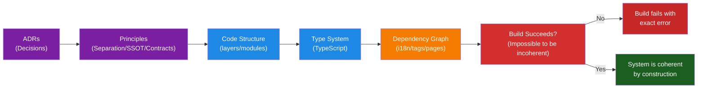

## 🎯 A Single Conviction

How you design systems determines whether quality is possible.

It's not about writing tests after code is done. It's about structuring the system so that
bad code **can't be written in the first place**.

Every decision about code organization, file structure, type system, and data flow reflects
one principle:

**Make the correct state the only possible state.**

---

## 🏗️ Three Architectural Principles

### 1. **Separation of Concerns** — Clarity Through Isolation

When business logic lives completely separate from presentation, structure enforces clarity.

You can't leak presentation into business logic because they live in different layers.
Configuration can't drift because it's isolated. Each layer has one job. The consequences:

- Changes are localized. Refactoring doesn't cascade unexpectedly.
- Testing is deterministic. Business logic has no UI dependencies to mock.
- Code explains itself. Structure is readable.

This is architecture as constraint.

### 2. **Single Source of Truth** — No Hidden Decisions

Centralized decisions mean centralized updates.

When the rules live in one place (`standalonePage.ts`, `tags.ts`, `ui.ts`), changing them
propagates everywhere. There's nowhere to hide a forgotten update.

Type systems make this visible. If you rename a tag, every page using that tag breaks at
compile time, not in production.

The compiler enforces consistency. It becomes your co-author.

### 3. **Explicit Contracts** — Structure as Law

When every boundary is declared with types, ambiguity disappears.

The i18n system depends on the dependency graph being coherent. Circular dependencies break
the build. Missing translation links are compile errors (every content piece must declare which languages it supports).
Missing translations within those supported languages are valid states (`draft`, `missing`). Invalid states can't be created.

This isn't validation that catches bugs. This is architecture that makes bugs impossible.

The consequence? The build either succeeds or tells you *exactly* what's wrong.

---

## 🌱 Why It Matters

A system built this way has profound consequences:

- **Safety**: Bad states are impossible to create
- **Velocity**: Refactoring is safe because constraints are enforced
- **Clarity**: Structure is self-explanatory
- **Scalability**: New developers can't violate the architecture

You're not just building software. You're building a system that **can't be built wrong**.

---

## 🔗 How It Connects to Implementation

These principles aren't abstract. They're embedded in concrete structure:

### Domain Layer

Business logic lives in isolation. No UI imports, no external dependencies in core logic.
This is why:

- `src/domain/` contains pure functions, types, constants
- Nothing in `domain/` imports components or routes
- Tests for domain are fast, deterministic, dependency-free

### Boundary Layer

Presentation doesn't know about business rules.

- Components are composition + rendering only
- Routing is metadata, not logic
- Pages assemble domain + components, never the reverse

### Type System as Enforcement

TypeScript isn't optional documentation. It's law.

- All i18n keys are checked: missing a key fails the build
- All routes are registered: missing a slug fails the build
- All tags exist: inventing a tag fails the build
- Circular dependencies fail the build

The type system makes violations impossible before code runs.

### Dependency Graph as Architecture

The flow of information is frozen in structure:

- `standalonePage.ts` is the single source of truth for page routing
- `tags.ts` is the single source of truth for content tags
- `ui.ts` is the single source of truth for strings
- Change any one, and TypeScript tells you everywhere else that needs updating

You can't forget to update something. The compiler won't let you.

---

## 📊 Design to Validation

The flow is unidirectional. Each layer depends on the previous one. No cycles.
If you violate this structure, the build fails.

---

## 📖 Deeper Exploration

- **[ADRs](https://github.com/secorto/secorto_web/tree/master/docs/adr)** —
  The "why" behind decisions
- **[Coding Guidelines](https://github.com/secorto/secorto_web/blob/master/docs/CODING_GUIDELINES.md)** —
  How principles translate to code
- **[Testing Strategy](https://github.com/secorto/secorto_web/blob/master/docs/architecture/TESTING_STRATEGY.md)** —
  How validation enforces what architecture enables
- **[Development Workflow](https://github.com/secorto/secorto_web/blob/master/docs/architecture/DEVELOPMENT_WORKFLOW.md)**
   — How the pipeline makes constraints real

For technical teams, the repository demonstrates these principles in practice across
type system, dependency structure, and module organization.
