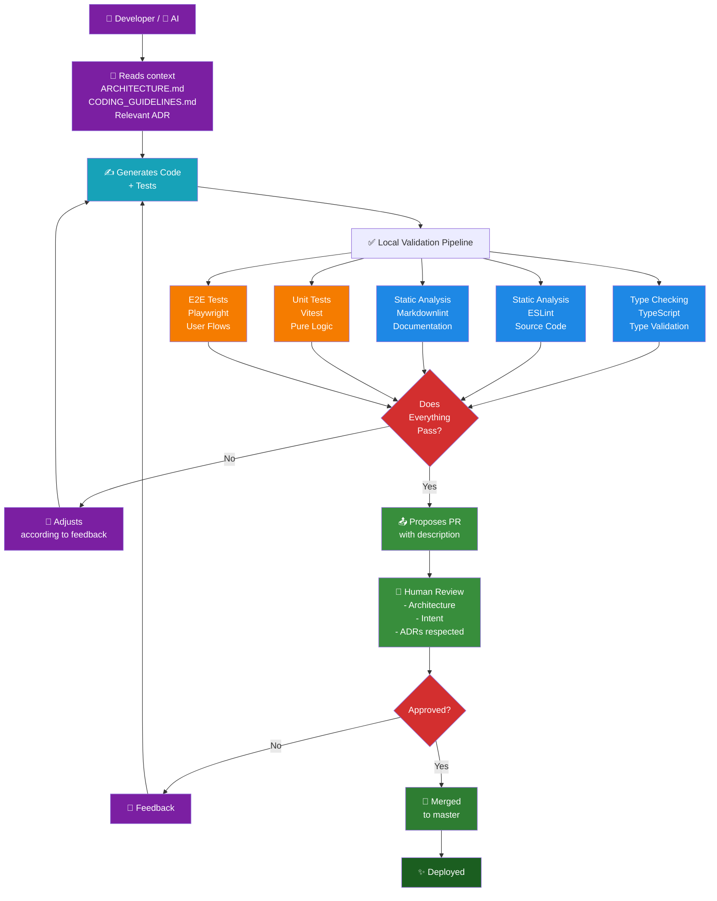

## 🎯 A Single Conviction

Quality doesn't live in a test report. It lives in how we think about validation.

Every test, every assertion, every mock reflects one principle:
**the system must prove itself correct at every stage**. Not after deployment. Not in staging.
*During development*.

This means testing isn't a checkpoint at the end. It's the language we use to
think about the system.

---

## 🏗️ Three Validation Pillars

### 1. **Shift Left** — Find Issues Early

When tests run during development, not production, something magical happens:
you catch problems before they become expensive.

The consequence? Unit tests validate business logic before UI rendering.
Linting catches structural issues before runtime. Each layer is tested in isolation,
integration validated in E2E.

This is how you build systems where quality is a built-in feature.

### 2. **Deterministic Mocks** — Control the World

When third-party services are mocked, tests become reproducible.
No flaky waits for external APIs. No "it passed locally but failed in CI".

Mock strategy isn't about avoiding reality; it's about controlling what you can control,
so you can test what matters.

This is how you build reliable test suites.

### 3. **CI/CD as Enforcement** — Automated Guardrails

When linting, type checking, and testing are part of the pipeline, they're not optional.

Every commit must pass all stages. The machine validates coherence automatically.
No "we'll fix that later"—the system won't let you ship broken code.

This is how you build systems that respect themselves.

---

## 🌱 Why It Matters

A system validated this way has profound consequences:

- **Safety**: Errors are caught before users see them
- **Velocity**: When tests are part of the thinking, iteration is fast
- **Clarity**: Tests that run cleanly are tests that explain intent
- **Collaboration**: Automated guardrails eliminate ambiguity

You're not just writing tests. You're building a system that **validates itself at every step**.

---

## 🔄 The Validation Pipeline — Quality Proven

This isn't theoretical. It's **proven at every commit**.

Before code ever reaches a reviewer, a machine validates it:

1. **Type Checking** — TypeScript verifies contracts are kept
2. **Static Analysis** — ESLint enforces structure, no leaky abstractions  
3. **Unit Tests** — Business logic is tested in isolation
4. **E2E Tests** — Complete user flows validate that testing strategy actually works

Each stage validates a different aspect of quality. Together, they prove the system is sound.

- **Shift Left** → Proven by unit tests running during development
- **Deterministic Mocks** → Proven by E2E tests not flaking despite external dependencies
- **CI/CD as Enforcement** → Proven by the build itself rejecting incoherent code

The pipeline is how the system **proves its own correctness**.

### The Complete Flow

**Legend:**

- 🟣 **Reading & Feedback** (purple) — Initial context and correction loops
- 🔷 **Generation** (cyan) — Heart of the workflow (code + tests)
- 🔵 **Type Check + Linting** (blue) — **Static** validation (without running code)
- 🟠 **Unit + E2E Tests** (orange) — **Dynamic** validation (executable)
- 🔴 **Decision Points** (red) — Branching (does it pass? approved?)
- 🟢 **Review + Merge + Deploy** (green) — Human approves, deploys, and closes

---

## 📖 Deeper Exploration

Quality by Design isn't just a testing practice; it's an architecture.

- **[Principles](https://github.com/secorto/secorto_web/blob/master/docs/ARCHITECTURE.md)** —
  How testing connects with overall design
- **[Testing](https://github.com/secorto/secorto_web/blob/master/docs/architecture/TESTING_STRATEGY.md)** —
  Unit, component, page, and flow testing approach
- **[Decisions](https://github.com/secorto/secorto_web/tree/master/docs/adr)** —
  Why these testing choices were made
- **[Workflow](https://github.com/secorto/secorto_web/blob/master/docs/architecture/DEVELOPMENT_WORKFLOW.md)** —
  Validation pipeline in action

For teams interested in implementation details, the repository contains testing examples,
page object patterns, and E2E flows demonstrating shift-left in practice.
