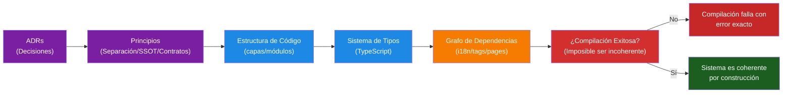

## 🎯 Una Única Convicción

La forma en que diseñas sistemas determina si la calidad es posible.

No se trata de escribir tests después de que el código está hecho. Se trata de estructurar el sistema de modo que
**el código incorrecto no pueda ser escrito en primer lugar**.

Cada decisión sobre organización de código, estructura de archivos, sistema de tipos y flujo de datos refleja
un principio:

**Haz que el estado correcto sea el único estado posible.**

---

## 🏗️ Tres Principios Arquitectónicos

### 1. **Separación de Responsabilidades** — Claridad a Través del Aislamiento

Cuando la lógica de negocio vive completamente separada de la presentación, la estructura refuerza la claridad.

No puedes filtrar presentación en lógica de negocio porque viven en diferentes capas.
La configuración no puede desviarse porque está aislada. Cada capa tiene un trabajo. Las consecuencias:

- Los cambios son localizados. La refactorización no se propaga inesperadamente.
- Las pruebas son deterministas. La lógica de negocio no tiene dependencias de UI para simular.
- El código se explica a sí mismo. La estructura es legible.

Esto es arquitectura como restricción.

### 2. **Una Única Fuente de Verdad** — Sin Decisiones Ocultas

Decisiones centralizadas significan actualizaciones centralizadas.

Cuando las reglas viven en un único lugar (`standalonePage.ts`, `tags.ts`, `ui.ts`), cambiarlas
se propaga por todas partes. No hay lugar donde ocultar una actualización olvidada.

Los sistemas de tipos hacen esto visible. Si renombras una etiqueta, cada página que la use se rompe en
tiempo de compilación, no en producción.

El compilador refuerza la consistencia. Se convierte en tu coautor.

### 3. **Contratos Explícitos** — Estructura como Ley

Cuando cada límite es declarado con tipos, la ambigüedad desaparece.

El sistema i18n depende de que el grafo de dependencias sea coherente. Las dependencias circulares rompen
la compilación. Los translation links faltantes son errores de compilación (cada contenido debe declarar qué idiomas soporta).
Las traducciones faltantes dentro de esos idiomas soportados son estados válidos (`draft`, `missing`).
Los estados inválidos no pueden ser creados.

Esto no es validación que atrape bugs. Esta es arquitectura que hace que los bugs sean imposibles.

¿La consecuencia? La compilación logra éxito o te dice *exactamente* qué está mal.

---

## 🌱 Por Qué Importa

Un sistema construido de esta manera tiene consecuencias profundas:

- **Seguridad**: Es imposible crear estados inválidos
- **Velocidad**: La refactorización es segura porque las restricciones se refuerzan
- **Claridad**: La estructura se autoexplica
- **Escalabilidad**: Los nuevos desarrolladores no pueden violar la arquitectura

No solo estás construyendo software. Estás construyendo un sistema que **no puede ser construido incorrectamente**.

---

## 🔗 Cómo se Conecta con la Implementación

Estos principios no son abstractos. Están embebidos en estructura concreta:

### Capa de Dominio

La lógica de negocio vive en aislamiento. Sin importaciones de UI, sin dependencias externas en la lógica central.
Por eso:

- `src/domain/` contiene funciones puras, tipos, constantes
- Nada en `domain/` importa componentes o rutas
- Las pruebas para domain son rápidas, deterministas, libres de dependencias

### Capa de Límite

La presentación no conoce sobre reglas de negocio.

- Los componentes son solo composición + renderización
- El enrutamiento es metadatos, no lógica
- Las páginas ensamblan el dominio + componentes, nunca al revés

### Sistema de Tipos como Refuerzo

TypeScript no es documentación opcional. Es ley.

- Todas las claves i18n son verificadas: una clave faltante rompe la compilación
- Todas las rutas están registradas: un slug faltante rompe la compilación
- Todas las etiquetas existen: inventar una etiqueta rompe la compilación
- Las dependencias circulares rompen la compilación

El sistema de tipos hace que las violaciones sean imposibles antes de que el código se ejecute.

### Grafo de Dependencias como Arquitectura

El flujo de información se congela en la estructura:

- `standalonePage.ts` es la única fuente de verdad para enrutamiento de páginas
- `tags.ts` es la única fuente de verdad para etiquetas de contenido
- `ui.ts` es la única fuente de verdad para strings
- Cambia cualquiera, y TypeScript te dice todos los demás lugares que necesitan actualización

No puedes olvidar actualizar algo. El compilador no te lo permitirá.

---

## 📊 Diseño a Validación

El flujo es unidireccional. Cada capa depende de la anterior. Sin ciclos.
Si violas esta estructura, la compilación falla.

---

## 📖 Exploración Más Profunda

- **[ADRs](https://github.com/secorto/secorto_web/tree/master/docs/adr)** —
  El "por qué" detrás de decisiones
- **[Coding Guidelines](https://github.com/secorto/secorto_web/blob/master/docs/CODING_GUIDELINES.md)** —
  Cómo los principios se traducen a código
- **[Testing Strategy](https://github.com/secorto/secorto_web/blob/master/docs/architecture/TESTING_STRATEGY.md)** —
  Cómo la validación refuerza lo que la arquitectura permite
- **[Development Workflow](https://github.com/secorto/secorto_web/blob/master/docs/architecture/DEVELOPMENT_WORKFLOW.md)**
  — Cómo el pipeline hace reales las restricciones

Para equipos técnicos, el repositorio demuestra estos principios en la práctica en todo el
sistema de tipos, estructura de dependencias y organización de módulos.
