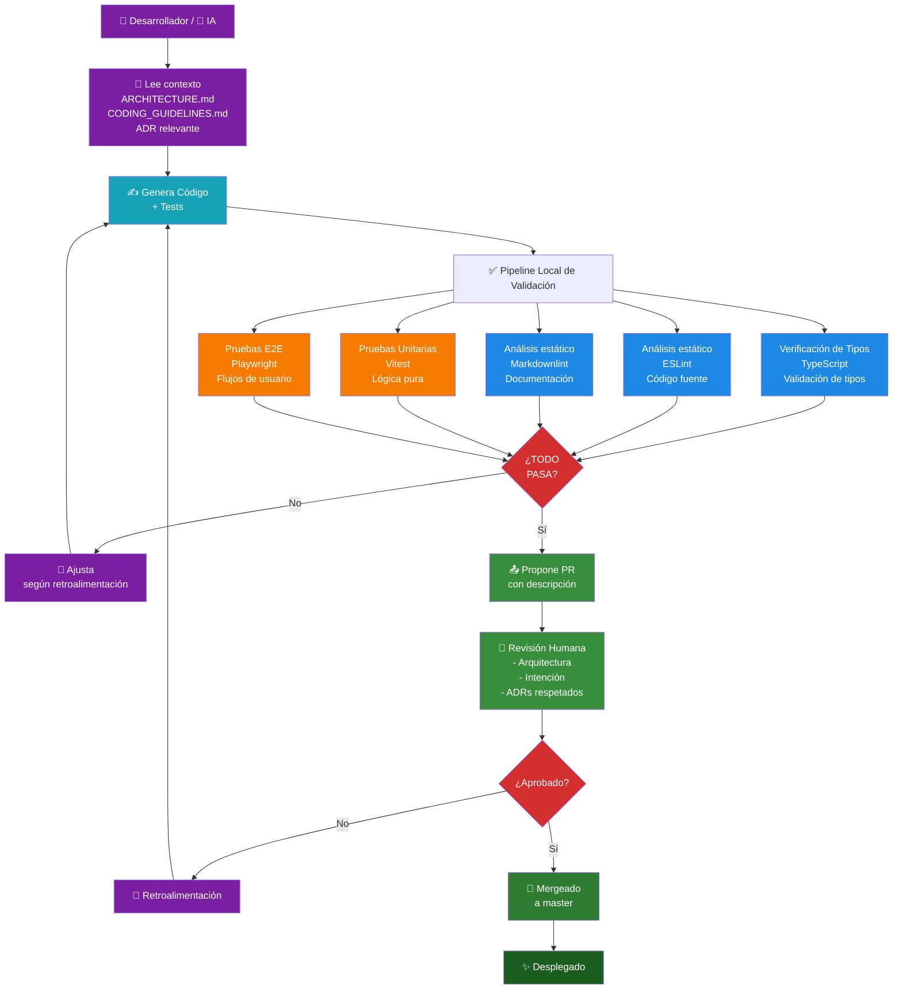

## 🎯 Una Única Convicción

La calidad no vive en un reporte de tests. Vive en cómo piensas sobre la validación.

Cada prueba, cada aserto, cada mock refleja un principio:
**el sistema debe demostrar que es correcto en cada etapa**. No después del despliegue. No en staging.
*Durante el desarrollo*.

Esto significa que las pruebas no son un punto de control al final. Es el lenguaje que usamos para
pensar sobre el sistema.

---

## 🏗️ Tres Pilares de Validación

### 1. **Shift Left** — Encontrar Problemas Temprano

Cuando las pruebas se ejecutan durante el desarrollo, no en producción, sucede algo mágico:
atrapas problemas antes de que se conviertan en costosos.

¿La consecuencia? Las pruebas unitarias validan lógica de negocio antes de renderizar UI.
El linting atrapa problemas estructurales antes del runtime. Cada capa se prueba en aislamiento,
la integración se valida en E2E.

Así es cómo construyes sistemas donde la calidad es una característica integrada.

### 2. **Mocks Deterministas** — Controlar el Mundo

Cuando los servicios de terceros están mockeados, las pruebas se vuelven reproducibles.
Sin esperas flaky por APIs externas. Sin "pasó localmente pero falló en CI".

La estrategia de mocks no se trata de evitar la realidad; se trata de controlar lo que puedes
controlar, para que puedas probar lo que importa.

Así es cómo construyes suites de pruebas confiables.

### 3. **CI/CD como Enforcement** — Guardrails Automatizados

Cuando linting, type checking y testing son parte del pipeline, no son opcionales.

Cada commit debe pasar todas las etapas. La máquina valida coherencia automáticamente.
No "arreglaremos eso después" — el sistema no te dejará desplegar código roto.

Así es cómo construyes sistemas que se respetan a sí mismos.

---

## 🌱 Por Qué Importa

Un sistema validado de esta manera tiene consecuencias profundas:

- **Seguridad**: Los errores son atrapados antes de que los usuarios los vean
- **Velocidad**: Cuando las pruebas son parte del pensamiento, la iteración es rápida
- **Claridad**: Las pruebas que corren limpiamente son pruebas que explican intención
- **Colaboración**: Los guardrails automatizados eliminan ambigüedad

No solo estás escribiendo pruebas. Estás construyendo un sistema que **se valida a sí mismo en cada paso**.

---

## 🔄 El Pipeline de Validación — Calidad Probada

Esto no es teórico. Se **prueba en cada commit**.

Antes de que el código llegue a un revisor, una máquina lo valida:

1. **Verificación de Tipos** — TypeScript verifica que los contratos se cumplen
2. **Análisis Estático** — ESLint refuerza estructura, sin abstracciones que se filtren
3. **Pruebas Unitarias** — La lógica de negocio se prueba en aislamiento
4. **Pruebas E2E** — Los flujos completos del usuario validan que la estrategia de testing realmente funciona

Cada etapa valida un aspecto distinto de la calidad. Juntas, prueban que el sistema es sólido.

- **Shift Left** → Probado por pruebas unitarias ejecutándose durante el desarrollo
- **Mocks Deterministas** → Probado por pruebas E2E que no fallan flakily a pesar de dependencias externas
- **CI/CD como Enforcement** → Probado por la compilación rechazando código incoherente

El pipeline es cómo el sistema **prueba su propia corrección**.

### El Flujo Completo

**Leyenda:**

- 🟣 **Lectura & Retroalimentación** (púrpura) — Contexto inicial y bucles de corrección
- 🔷 **Generación** (cyan) — Corazón del flujo (código + tests)
- 🔵 **Verificación de Tipos + Linting** (azul) — Validación **estática** (sin ejecutar código)
- 🟠 **Pruebas Unitarias + E2E** (naranja) — Validación **dinámica** (ejecutable)
- 🔴 **Puntos de decisión** (rojo) — Bifurcaciones (¿pasa validación? ¿aprobado?)
- 🟢 **Revisión + Merge + Despliegue** (verde) — Humano aprueba, despliega y cierra

---

## 📖 Exploración Más Profunda

Quality by Design no es solo una práctica de testing; es una arquitectura.

- **[Principios](https://github.com/secorto/secorto_web/blob/master/docs/ARCHITECTURE.md)** —
  Cómo testing se conecta con diseño
- **[Testing](https://github.com/secorto/secorto_web/blob/master/docs/architecture/TESTING_STRATEGY.md)** —
  Enfoque para unit, component, page y flow testing
- **[Decisiones](https://github.com/secorto/secorto_web/tree/master/docs/adr)** —
  Por qué se tomaron estas decisiones de testing
- **[Workflow](https://github.com/secorto/secorto_web/blob/master/docs/architecture/DEVELOPMENT_WORKFLOW.md)** —
  Pipeline de validación en acción

Para equipos interesados en detalles de implementación, el repositorio contiene
ejemplos de testing, patrones de page objects y flujos E2E demostrando shift-left en práctica.
